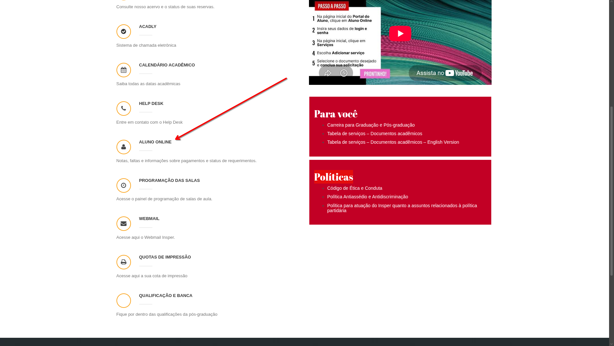
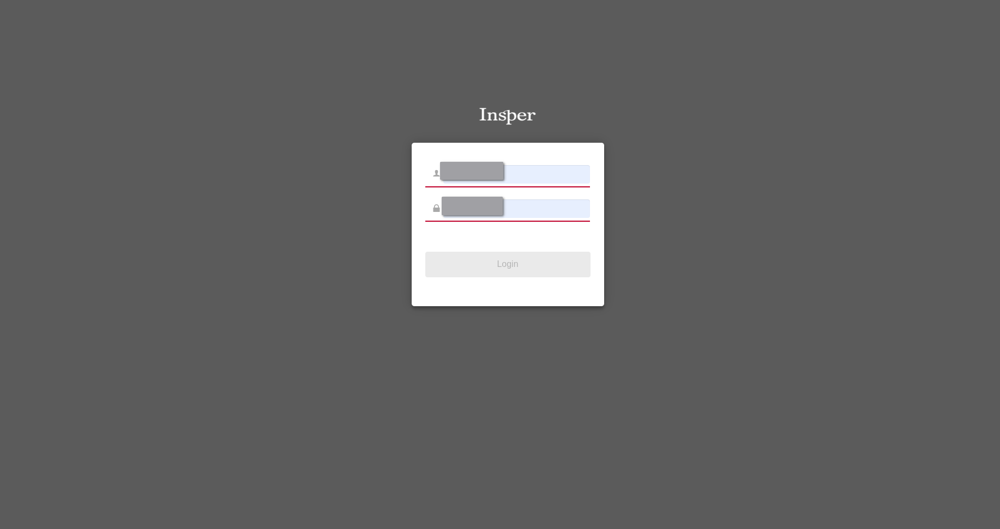
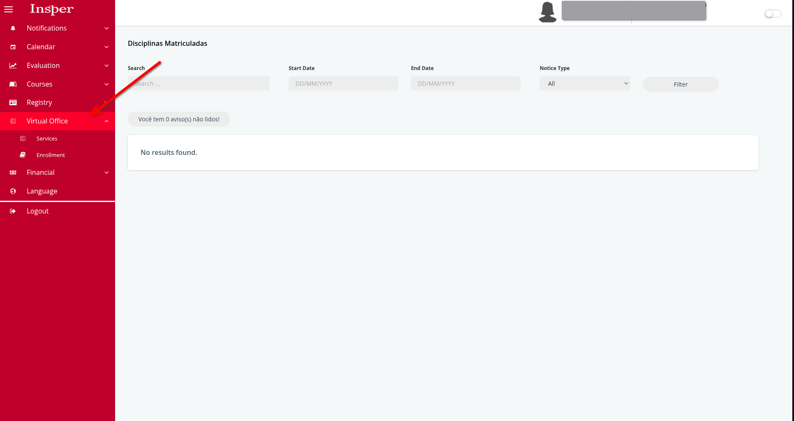
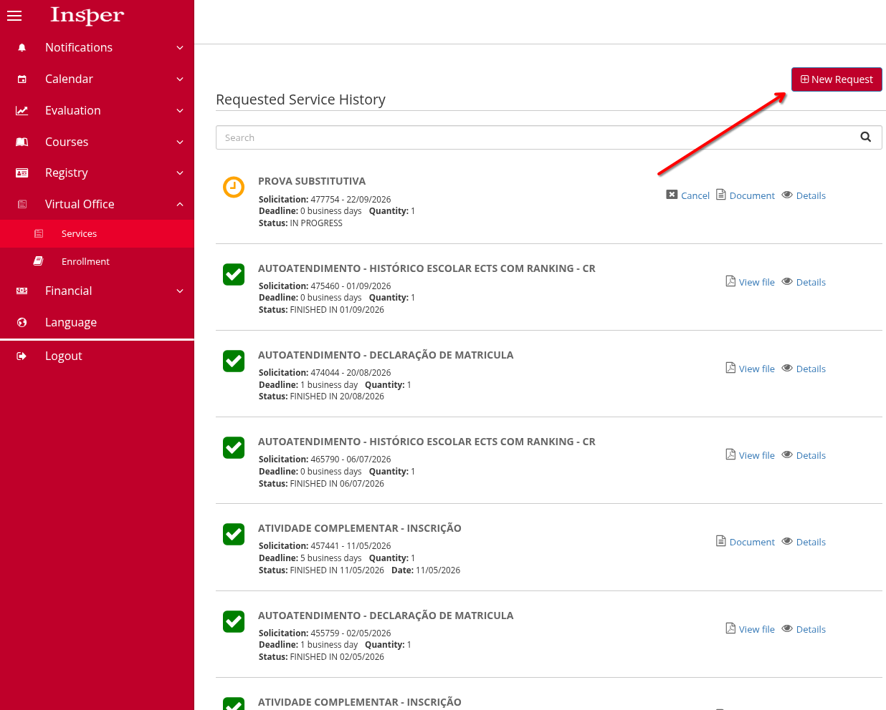
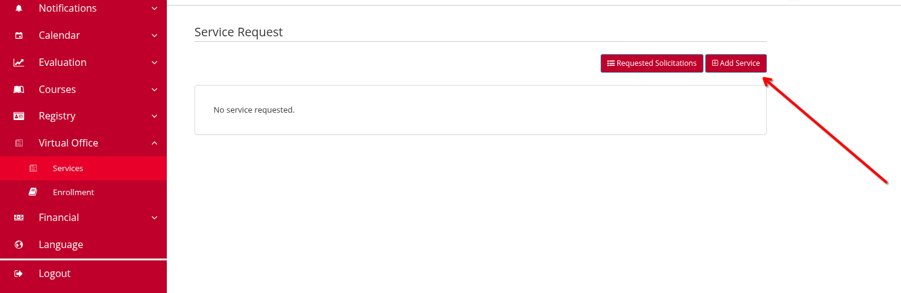
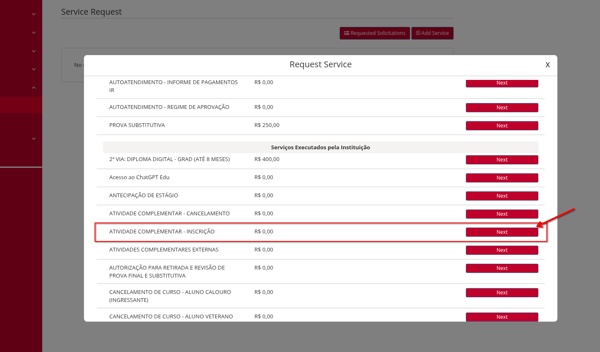
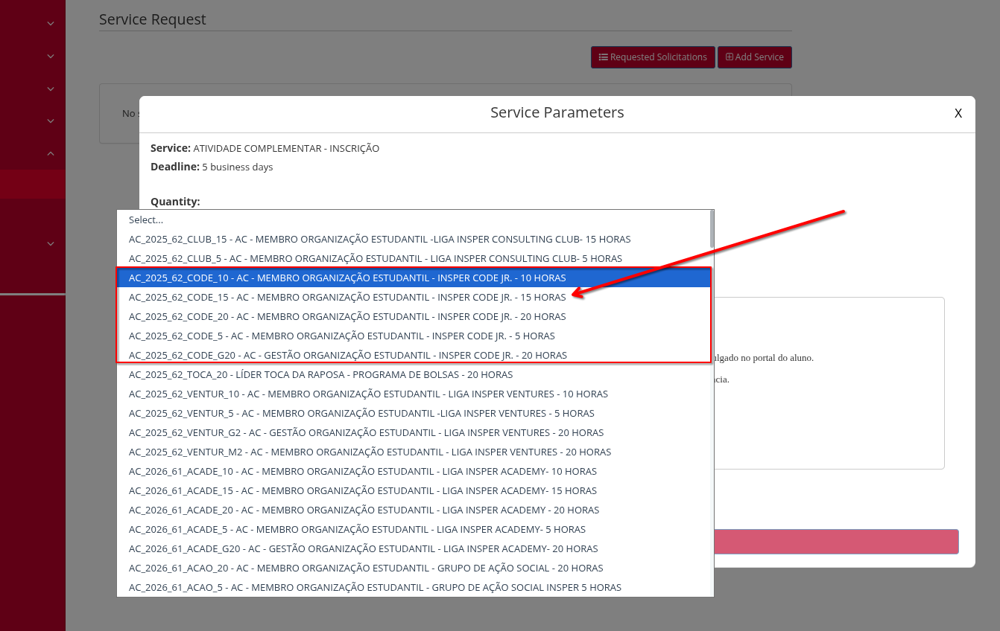

# Presença e horas do semestre

Regras de presença, justificativas de falta e atribuição de horas dos
membros.

## Presença nas capacitações

Novos membros: presença obrigatória em todas as capacitações, ou em pelo
menos 75% dos encontros.

Membros antigos: participação parcialmente obrigatória, com presença em
pelo menos 50% das capacitações.

## Faltas e justificativas

!!! warning "Prioridade acadêmica"
    O Code não incentiva, em nenhuma hipótese, faltar a aulas, atendimentos
    ou monitorias para se dedicar às atividades da entidade. Quando uma
    atividade do Code conflitar com uma atividade acadêmica, priorize a
    atividade acadêmica e justifique a ausência no Code.

Para justificar uma ausência, envie mensagem ao Diretor de RH pelo WhatsApp
`+55 16 99220-3264` com:

- nome completo;
- data da falta;
- justificativa comprovada, como foto da grade horária ou agendamento de
  consulta médica.

!!! danger "Não são aceitas"
    Justificativas como "tenho APS para entregar" ou "vou viajar".

## Sistema de atribuição de horas

| Horas | Critério |
| --- | --- |
| 20h | Diretoria. |
| 10h | Membro presente em mais de 75% das capacitações e sem falta em reunião geral, exceto falta justificada. |
| 15h | Membro com participação em 100% dos eventos ou desempenho notável durante o semestre. |

## Cadastrar horas complementares

As horas de participação no Code precisam ser registradas oficialmente como
**Atividade Complementar** no [Portal do Aluno](https://portaldoaluno.insper.edu.br).
Siga o passo a passo abaixo.

1. Acesse o [Portal do Aluno](https://portaldoaluno.insper.edu.br) 

    

2. No menu lateral, clique em **Aluno Online**.

    

3. Faça login com o seu usuário e senha do Insper.

    

4. Já dentro do Aluno Online, no menu lateral, clique em **Virtual Office** ou **Secretaria Virtual**
   para abrir o submenu.

    

5. Clique em **Services** e, na tela de **Requested Service History**, clique
   no botão **New Request**/ **Nova Solicitação**.

    

6. Na tela de **Service Request**, clique em **Add Service**/ **Adicionar serviço**.

    

7. Na lista de serviços que abrir, procure por **ATIVIDADE COMPLEMENTAR -
   INSCRIÇÃO** e clique em **Next** na linha correspondente.

    

8. Em **Service Parameters**, no campo **Quantity**, selecione a opção
   referente ao Code e à quantidade de horas que você está cadastrando (por
   exemplo, `AC_2025_62_CODE_10 - AC - MEMBRO ORGANIZAÇÃO ESTUDANTIL - INSPER
   CODE JR. - 10 HORAS`) e conclua o envio da solicitação.

    